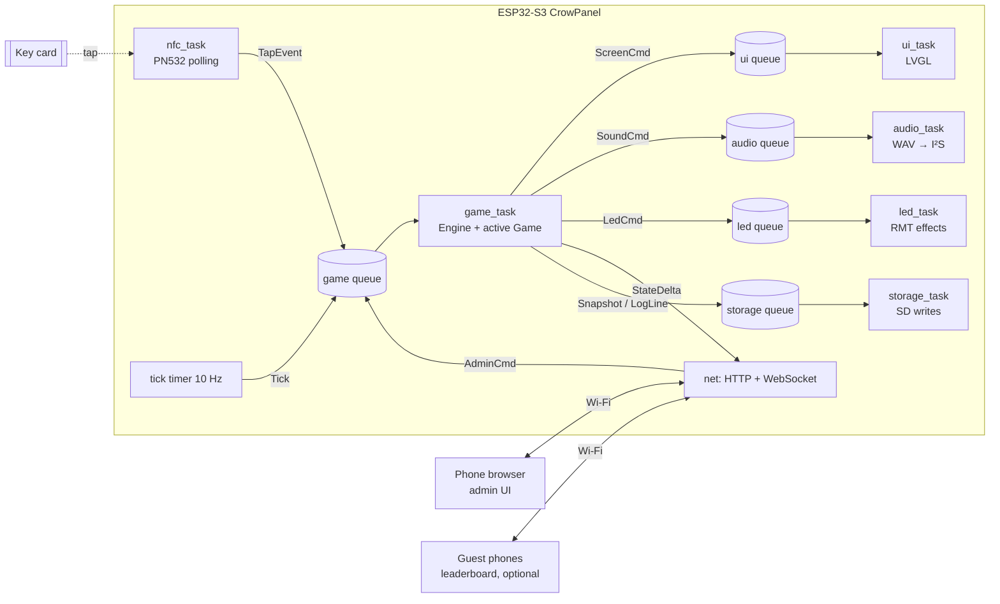

# ORCA Reader Costume — Architecture

> A wearable, working parody of Seattle's ORCA tap-to-pay terminal. Guests get programmed
> key cards, tap the costume, and play games. The wearer runs the show from a phone.

Status: draft v0.1 · 2026-10-13 · Target: Halloween 2026-10-31

---

## 1. Goals and non-goals

**Goals**
- Tapping a card feels like a real ORCA reader: an instant beep, a green/red screen, a "fare" message. Under 300 ms from tap to feedback.
- **Pluggable game modes.** Adding a game means writing one class and registering it. The engine, hardware, and phone UI don't change.
- **Phone control panel** over Wi-Fi: pick and configure games, start/stop/reset, trigger bonus events, manage players, see live status.
- **Survives a party.** If the battery gets swapped, the power browns out, or the device reboots, scores and game state come back.
- Runs all night on a USB battery bank.

**Non-goals**
- Touch input (the panel's touch controller is left unused).
- Card security. Cloned cards are an acceptable Halloween risk.
- Internet connectivity or a cloud backend.

---

## 2. Hardware

| Part | Role | Interface |
|---|---|---|
| Elecrow CrowPanel 5.0" (ESP32-S3-WROOM-1, 8 MB PSRAM, 800×480 RGB LCD) | MCU, display, SD slot, speaker header | — |
| Elechouse PN532 NFC V3 | Card reader | **I²C** (shares the touch I²C header) |
| 8 Ω speaker | Beeps, voice lines, music stings | Panel's speaker connector (onboard I²S amp) |
| WS2812 LED strip/ring | Ambient light and tap effects | One GPIO through the RMT peripheral |
| MicroSD | Sounds, images, config, save state, logs | SPI (onboard slot) |
| USB battery bank (≥ 20 000 mAh, ≥ 2.4 A port, ideally 2 ports) | Power | USB-C → panel; second port → LEDs |

### 2.1 Pin budget

The RGB LCD uses most of the ESP32-S3's GPIOs. Only the broken-out headers are free.
Pins are from the [Elecrow wiki](https://elecrow.com/wiki/esp32-display-502727-intelligent-touch-screen-wi-fi26ble-800480-hmi-display.html)
(checked 2026-10-13). Re-check against the schematic for your board revision before wiring.

| Function | Pins | Notes |
|---|---|---|
| LCD RGB data | B: 8, 3, 46, 9, 1 · G: 5, 6, 7, 15, 16, 4 · R: 45, 48, 47, 21, 14 | RGB565, 800×480 |
| LCD control | DE 40, VSYNC 41, HSYNC 39, PCLK 0 | 15 MHz pclk (ESPHome uses 12 MHz). HSYNC fp/pw/bp 8/4/43, VSYNC 8/4/12, pclk active on the falling edge. |
| Backlight | GPIO 2 | PWM-dimmable (LEDC). |
| SD card (SPI) | CS 10, MOSI 11, CLK 12, MISO 13 | Onboard slot. |
| I²C header (touch bus) | SDA 19, SCL 20 | **PN532 goes here** (0x24). It shares the bus with the GT911 touch IC (0x5D/0x14) and, on v3.0 boards, a PCA9557 I/O expander (0x18). None of these clash. |
| Speaker (I²S → onboard amp) | LRCLK 18, BCLK 42, DOUT 17 | PH2.0 2-pin speaker connector, with an amplifier on the board. |
| GPIO_D header | GPIO 38 | **WS2812 data.** This is the only spare GPIO. |
| UART header | TX 43, RX 44 | **These are the UART0 pins, shared with the USB serial bridge.** They're not usable for the PN532 while flashing and logging over USB. |

**Board identity, confirmed 2026-10-13** with `esptool flash_id` and the boot log: ESP32-S3 (QFN56, rev v0.2),
**4 MB quad flash, 8 MB embedded octal PSRAM** (N4R8). The panel was verified with full-screen
R/G/B/white/black fills and an R|G|B band pattern at 15 MHz pclk: colors and orientation are correct.
The factory firmware is backed up at `~/esp/backups/crowpanel5-factory-a4cb8fcdce88.bin`
(restore with `esptool.py write_flash 0 <file>`).

**PN532 link: I²C.** There's no free UART, so I²C is the only option that doesn't cost the last GPIO. The PN532 stretches the I²C clock, which can make it flaky on the ESP32. Mitigations: run the bus at 100 kHz, use the PN532's IRQ-less polling with generous timeouts, and auto-reinit after faults. Fallback if I²C is unusable: SPI to the PN532 using GPIO 38 plus pins freed by giving up the SD card, which is a major trade-off. Set the PN532 DIP switches to I²C.

**WS2812 level shifting.** The 3.3 V data line often works with 5 V pixels, but not reliably. Use a 74AHCT125 (or a single "sacrificial" pixel powered at ~4.3 V) plus a 330 Ω series resistor and a 1000 µF cap across the strip's power.

### 2.2 Power budget (rough)

| Load | Typical | Peak |
|---|---|---|
| ESP32-S3 + Wi-Fi AP | 120 mA | 400 mA |
| 5" panel + backlight (80%) | 350 mA | 450 mA |
| Audio (8 Ω, short clips) | 50 mA avg | 500 mA |
| WS2812 × 30 at a 25% brightness cap | 200 mA | 450 mA (capped in firmware) |
| **Total** | **~0.75 A** | **~1.8 A** |

A 20 000 mAh bank delivers roughly 12–13 Ah at 5 V, which is **about 15 hours**. Run the LEDs from the second port so their current spikes can't brown out the MCU. Firmware enforces a global LED current limit (see §6.5).

---

## 3. System overview



**Core rule: the game task owns all game state.** All other tasks talk to it only through
queues. That means no locks around game logic. It also keeps the engine and games free of
hardware dependencies, so they can be unit-tested on a laptop (§9).

---

## 4. Firmware structure

ESP-IDF v5.3+, C++17 for the app and game layers and C for the drivers, FreeRTOS SMP on both cores.

The code is split into a **portable core** (★ below: standard C++17 only, no ESP-IDF headers)
and thin **platform adapters**. The core builds two ways: as ESP-IDF components for the
device, and as a plain CMake project on macOS/Linux for unit tests and the host simulator.

```
firmware/
  main/                    app_main: board init, task startup, wiring of queues
  components/
    orca_hal/              ★ interfaces only: Clock, Random, CardReader, AudioOut, LedOut,
                           ScreenSink, FileSystem, KvStore, Transport (byte stream)
    game_core/             ★ Engine, Game interface, PlayerRegistry, ScoreBoard,
                           EventScheduler, Feedback/Theme mapping, snapshot (de)serialization
    games/                 ★ one file per game mode + registry
    api/                   ★ transport-agnostic web API: handle(ApiRequest) → ApiResponse,
                           WebSocket message encode/decode, auth/session logic
    pn532_proto/           ★ PN532 frame build/parse, checksums, NTAG payload codec
    fx_core/               ★ LED effect math + current limiter, WAV header parser, mixer
    config/                ★ config.json / sounds.json parsing + validation + defaults
    --- platform adapters (ESP-IDF) ---
    board/                 pin map, backlight, power-on sequencing (Kconfig per board rev)
    pn532/                 I²C Transport implementation over pn532_proto
    nfc/                   nfc_task: polling, debouncing, TapEvent emission
    display/               esp_lcd RGB panel + LVGL 9 port, screen templates
    audio/                 I²S output, SD streaming → fx_core mixer
    leds/                  led_strip (RMT) → fx_core frames
    storage/               SD mount, FileSystem impl, storage_task
    net/                   Wi-Fi, captive DNS, mDNS, esp_http_server ↔ api adapter
  test/                    on-target Unity tests for adapters (idf.py test app)
  partitions.csv
  sdkconfig.defaults
host/
  CMakeLists.txt           builds ★ components + tests + simulator natively
  fakes/                   FakeClock, SeededRandom, RecordingAudio/Leds/Screen, MemFileSystem,
                           ScriptedCardReader, LoopbackTransport
  tests/                   GoogleTest + gmock unit/property tests per ★ component
  scenarios/               *.scenario.json + *.expected.jsonl golden transcripts
  sim/                     orca-sim: CLI + localhost HTTP/WS server (cpp-httplib) over `api`
  display_sim/             (stretch) LVGL SDL2 build of screen templates + screenshot tests
web/                       phone UI (Preact + Vite + TypeScript), Vitest + Playwright tests
sd_card/                   layout template for the SD card (sounds, images, config.json)
tools/                     asset converters, card-label generator, hil/ smoke-test scripts
docs/
```

Fakes are injected where real hardware would be. On the device, `Clock` is `esp_timer`,
`Random` is `esp_random`, and the output interfaces post to queues. On the host they're
deterministic fakes that record every call.

---

## 5. FreeRTOS tasks

| Task | Core | Prio | Stack | Period / trigger | Responsibility |
|---|---|---|---|---|---|
| `nfc_task` | 0 | 6 | 4 KB | poll every 50 ms | Detect card, read UID (+ NTAG page if provisioned), debounce, post `TapEvent` |
| `game_task` | 0 | 5 | 8 KB | queue-driven, 10 Hz `Tick` | Engine + active game. The only writer of game state. |
| `ui_task` | 1 | 4 | 8 KB | `lv_timer_handler` every 5–10 ms | LVGL rendering. Applies `ScreenCmd`s. |
| `audio_task` | 1 | 7 | 6 KB | queue-driven | Streams WAV from SD to I²S in 4 KB chunks. Highest priority to avoid underruns. |
| `led_task` | 0 | 3 | 3 KB | 60 fps while animating, otherwise idle | Effect state machine pushing frames over RMT |
| `storage_task` | 0 | 2 | 6 KB | queue-driven | All SD writes (snapshots, logs). Keeps slow SD I/O off hot paths. |
| httpd (IDF) | 0 | 5 | 8 KB | — | REST + WebSocket handlers. These post `AdminCmd`s and never touch state directly. |
| Wi-Fi/LwIP (IDF) | 0 | — | — | — | — |

LVGL is pinned alone on core 1. The RGB panel's PSRAM framebuffer competes with Wi-Fi and SD
for bus bandwidth, so keep the UI core quiet.

### 5.1 Message types (sketch)

```cpp
struct TapEvent   { CardUid uid; uint64_t t_ms; std::optional<CardPayload> payload; };
struct Tick       { uint64_t t_ms; };
struct AdminCmd   { AdminOp op; json args; ReplyToken reply; };   // select_game, start, stop,
                                                                  // reset, adjust_score, rename,
                                                                  // trigger_event, set_volume...
using GameInput = std::variant<TapEvent, Tick, AdminCmd>;

struct Feedback {            // what the game wants the costume to do; the engine translates it
  Outcome     outcome;       // Accepted | Cooldown | Rejected | Bonus | Special | Unknown
  int         points_delta;
  std::string headline;      // "FARE PAID", "TRANSFER", "INSUFFICIENT FUNDS"
  std::string detail;        // "Balance: 42 pts · Next tap in 4:12"
  SoundId     sound;         // optional override; otherwise taken from the theme by outcome
  LedEffectId leds;          // optional override
  uint32_t    hold_ms = 2500;
};
```

---

## 6. Subsystems

### 6.1 NFC (`pn532` + `nfc`)

- **Cards:** NTAG215 cards (cheap, writable, about 500 B of user memory). MIFARE Classic cards also work as UID-only cards.
- **Identity = UID.** The 7-byte UID is the player key. Optionally, an NDEF record or a raw page holds `{ver, player_no, team}` so a card works on a freshly wiped device. This is the "programmed" part.
- **Polling:** `InListPassiveTarget` with a short timeout, every 50 ms. Use the RF field-off between polls only if heat or current is a problem.
- **Debounce:** The same UID is ignored for 1.5 s after a read, and the card has to leave the field before it can tap again. This stops one long hold from counting as several taps. This is separate from game cooldowns.
- **Health:** If the reader returns no response 3 times in a row, the task re-runs `SAMConfiguration`, then power-cycles the PN532 (RSTO pin if wired). It reports a `ReaderFault` to the engine, which shows on the admin UI.
- **Provisioning mode:** An admin command flips nfc_task into write mode. The next tap writes the payload to the card and registers it.

### 6.2 Game core (`game_core`)

```cpp
class Game {
 public:
  virtual ~Game() = default;
  virtual const GameInfo& info() const = 0;          // id, name, description, ParamSchema
  virtual void configure(const json& params) = 0;    // validated against ParamSchema
  virtual void start(GameContext& ctx) = 0;
  virtual void stop(GameContext& ctx) {}
  virtual Feedback on_tap(GameContext& ctx, Player& p, uint64_t now) = 0;
  virtual void on_tick(GameContext& ctx, uint64_t now) {}
  virtual void on_event(GameContext& ctx, const GameEvent& e) {}  // bonus window start/end, admin triggers
  virtual json status(const GameContext& ctx) const = 0;   // for phone UI + idle screen
  virtual json save() const = 0;                          // persisted in snapshot
  virtual void restore(const json& j) = 0;
};

struct GameContext {
  const Clock&     clock;
  Random&          rng;
  PlayerRegistry&  players;     // uid → Player{no, name, team, flags}
  ScoreBoard&      scores;      // per-session points, per-player stats, leaderboard
  EventScheduler&  events;      // timed / random windows (see 6.3)
  Effects&         fx;          // out-of-band effects: announce(), ambient(), play()
  KvStore&         kv;          // per-game scratch that survives restarts
};

#define REGISTER_GAME(Class) /* adds a factory to a static registry table */
```

**Engine responsibilities** (so that games stay small):
- Looks up or auto-enrolls the player on each tap. Unknown cards are rejected, or auto-added in "open enrollment" mode.
- Applies global rules before calling the game: the player is banned, the game is paused, the device is in provisioning mode.
- Applies the **multiplier stack** from the EventScheduler to `points_delta`.
- Turns a `Feedback` into screen, sound, and LED commands using the active **Theme** (default: ORCA).
- Pushes state deltas to WebSocket clients, and debounces snapshots to storage (at most once every 5 s, plus immediately on admin actions).

**ParamSchema** is a small declarative list such as `{key, type(int|float|bool|enum|duration), label, min, max, default}`.
The phone UI builds each game's settings form from this schema, so **a new game needs no
web UI changes.**

### 6.3 Event scheduler ("Rush Hour" and friends)

This is a cross-game feature for timed and random windows. Any game can use it.

- **Kinds:** `multiplier` (e.g. 2× points), `cooldown_waiver` (the next tap ignores cooldown), and `custom` (passed to `Game::on_event`).
- **Triggers:** random, with a Poisson-style schedule (e.g. "average every 20 min, lasting 2 min, with ±50% jitter"), fixed times, or manual from the phone.
- When a window opens, the engine plays an announcement sound, shows a banner, and switches the LEDs to the event's effect. When it closes, everything reverts.
- Games read `ctx.events.active()`. They can also opt out of multipliers.

### 6.4 Display (`display`)

- `esp_lcd_new_rgb_panel` with a **double framebuffer in PSRAM plus bounce buffers in internal SRAM**. Bounce buffers are the standard ESP32-S3 fix for display drift and tearing while Wi-Fi and SD are busy. If you still see drift, lower the pixel clock (around 14–16 MHz).
- LVGL 9 runs in direct/full-refresh mode on core 1.
- **Screen templates** (C++ functions that build LVGL objects). They're fixed layouts, so screens render fast and look consistent:
  - `Idle`: the ORCA-style "Tap card here" screen with an animated hand icon. It rotates through a leaderboard, the current game name, and the active event countdown.
  - `Result`: a full-screen color fill (green, amber, or red) with the headline, detail, and player name/number. Returns to Idle after `hold_ms`.
  - `Banner`: an overlay for event announcements.
  - `Fault`: "Reader out of service" (in character).
- Images (logos, icons) load from SD as pre-converted LVGL binary images (`.bin`, RGB565) into PSRAM at boot. Fonts are compiled in (two sizes of a bold sans that's close to ORCA's look).

### 6.5 LEDs (`leds`)

- `led_strip` component on the RMT backend, with the pixel count from config.
- Effects: `idle_breathe`, `accept_flash` (green), `reject_flash` (red ×2), `cooldown_pulse` (amber), `bonus_rainbow_chase`, `event_strobe`, `fault_blink`.
- A **global brightness cap** and a current estimator (sum of RGB × mA per channel) scale frames down so the LEDs never exceed `max_led_ma` from config.

### 6.6 Audio (`audio`)

- 16-bit mono WAV at 22.05 kHz on SD (small, decodes fast, sounds fine on an 8 Ω speaker).
- Two voices: **UI** (beeps, which preempt each other) and **voice/music** (announcements). They're mixed in software into one I²S stream.
- The ORCA-style beep is the key detail: a single high beep means accepted, a double low beep means rejected. These are cached in RAM at boot so they play with no SD latency. Everything else streams.
- Sound IDs map to files through `sounds.json` on SD, so you can swap sounds without reflashing.

### 6.7 Storage (`storage`)

SD layout:
```
/sdcard/
  config.json          wifi mode/ssid/pass, admin PIN, volume, brightness, led count/max_ma, theme
  sounds.json          sound-id → file map
  sounds/*.wav
  images/*.bin
  state/snapshot.json  players, scores, active game + save(), scheduler state
  state/snapshot.bak   previous snapshot (written first, then renamed: atomic-ish)
  logs/taps-YYYYMMDD.csv  t, uid, player_no, game, outcome, points
```
- At boot: load the config. If the SD card is missing, use defaults compiled into the firmware. Then restore the snapshot (falling back to `.bak` if the main one is corrupt) and resume the game. **Cooldowns are stored as remaining durations**, not absolute times, because the monotonic clock resets on reboot.
- NVS holds only a mirror of Wi-Fi credentials and the admin PIN, so the device can still be reached without an SD card.

### 6.8 Networking and phone UI (`net`, `web/`)

- **Wi-Fi mode** (from config):
  - `ap` (default): SSID `ORCA-READER`, WPA2, a captive-portal DNS redirect to the UI, and mDNS `orca.local`. Simple and needs no infrastructure. The ESP32 SoftAP tops out at about 8–10 clients.
  - `sta`: joins your phone's hotspot or the party Wi-Fi, and is reachable at `orca.local`. Use this if guests should see the leaderboard on their own phones.
  - Fallback: if STA fails for 30 s, bring up the AP.
- **Server:** `esp_http_server` serves the gzipped SPA from flash (with SD as an override for quick iteration). It also exposes a REST API and one WebSocket.
- **API layering:** All routing, validation, auth, and JSON shaping live in the portable `api` component as `ApiResponse handle(const ApiRequest&)`. It talks to the game task through an `EngineGateway` interface. On the device, the gateway posts an `AdminCmd` and waits on the reply token. On the host, it calls the engine directly. The `net` component only converts `httpd_req_t` to and from `ApiRequest`/`ApiResponse`, so it's around 100 lines with no logic to test.
- **Auth:** an admin PIN is exchanged for a session token in a cookie. Read-only endpoints (leaderboard, public status) don't need auth.
- **Clock sync:** the phone UI sends `Date.now()` when it connects. The device then knows the wall-clock time for logs and "at 10 pm" scheduling. Cooldowns use the monotonic clock only.

**API**

| Method | Path | Purpose |
|---|---|---|
| GET | `/api/status` | Device health, active game, event, uptime, reader state |
| GET | `/api/games` | Registered games + ParamSchemas |
| POST | `/api/game/select` `{id, params}` | Load and configure a game |
| POST | `/api/game/{start,pause,resume,stop,reset}` | Lifecycle |
| GET/PATCH | `/api/players[/:no]` | List players, rename, set team, ban, adjust score |
| POST | `/api/events/trigger` `{kind, duration, multiplier}` | Manual bonus window |
| POST | `/api/provision` `{player_no?, name?, team?}` | Arm write-on-next-tap |
| POST | `/api/sim/tap` `{uid}` | **Simulated tap** for testing without cards |
| POST | `/api/fx/sound` `{id}` | Play a soundboard clip |
| PATCH | `/api/settings` | Volume, brightness, LED cap, Wi-Fi (persisted) |
| WS | `/ws` | Server pushes `tap`, `score`, `event`, `status` messages. Client may send commands. |

**Phone UI pages:** Dashboard (game, timer, taps/min, last 10 taps live, reader health) ·
Games (pick, form from schema, start/stop/reset) · Players (search, rename, team, ±points, ban) ·
Events (trigger Rush Hour now, upcoming random events) · Soundboard · Settings · Public
Leaderboard (`/board`, no auth).

Mobile-first, one column, big buttons. Total gzipped size target is under 150 KB, served from flash.

---

## 7. Game modes

Each mode is one class in `games/`. Candidates, roughly in build order:

| Mode | Rules | Uses |
|---|---|---|
| **Fare Paid** (baseline) | +1 per tap, 5 min per-player cooldown (configurable). Tapping during cooldown shows "TRANSFER — next fare in 3:12". | Cooldown, Rush Hour multiplier |
| **Rush Hour** | Fare Paid plus frequent random 2×/3× windows. Mostly a preset of the scheduler. | Scheduler |
| **Team Lines** | Cards are assigned to teams (Link Light Rail, RapidRide, Sounder, Water Taxi…). Team totals are shown. The LED color follows the leading team. | Teams |
| **Fare Inspector** | Random "inspection" windows: players who tapped in the last N minutes are safe, and players who tap during the window without a recent fare lose points. Encourages staying active. | Scheduler custom event |
| **Last Stop** (king of the hill) | The last card to tap "rides the bus" and earns 1 pt every 30 s until someone else taps. Per-player cooldown is short (60 s). | on_tick scoring |
| **Route Collector** | Each tap stamps a random "station". Completing a line (e.g. all 1 Line stations) is worth a bonus. Shows progress on screen. | Per-player kv |
| **Golden Ticket** | At a random time, a secret target player number is chosen. Whoever brings that card (or is that card) in the next N minutes wins big. Announced on screen. | Scheduler |
| **Lottery / Last Call** | Every tap is an entry, and the finale draws weighted winners with a dramatic animation. Good to run at the end of the night. | Admin trigger |

All modes share the ORCA feedback vocabulary: "FARE PAID", "TRANSFER", "INSUFFICIENT FUNDS",
"CARD NOT RECOGNIZED", "SEE CUSTOMER SERVICE" (banned).

---

## 8. Key flows

**Tap → feedback (hot path, < 300 ms target)**
1. `nfc_task` reads the UID (about 30–60 ms), debounces it, and posts a `TapEvent`.
2. `game_task`: registry lookup → engine pre-checks → `game.on_tap()` → multiplier → `Feedback`.
3. The engine immediately posts `SoundCmd(beep)`, then `LedCmd`, then `ScreenCmd(Result)`. The beep goes first because it's the cue people notice first.
4. The engine then posts a WebSocket delta and a log line. The snapshot is debounced.

**Boot**
Power → board init → SD mount → config → display "booting" splash → Wi-Fi → restore snapshot →
start tasks → Idle screen + startup chime. Target: tap-ready in under 5 s.

**Reboot mid-game**
The snapshot restores the players, scores, game `save()` state, and remaining cooldowns and
event windows. A small "Service restored" banner appears.

---

## 9. Testing strategy

Most tests should run on the laptop in seconds. A few run on the device, and a few physical
checks are done by hand.

```
          ▲ manual: range, battery, dress rehearsal        (few, slow)
          │ HIL smoke: flash + sim taps + serial + webcam
          │ on-target Unity tests (adapters only)
          │ E2E: Playwright web UI ↔ orca-sim
          │ scenario/golden tests (orca-sim, headless)
          │ property tests (random tap streams + invariants)
          ▼ unit tests per ★ component                      (many, fast)
```

### 9.1 Host unit tests (GoogleTest + gmock)

Run with `cmake --build host/build && ctest`. The target is under 10 s and a pass on every change.

| Component | What's tested |
|---|---|
| `game_core` | Player lookup/enrollment, bans, pause, the multiplier stack, Feedback→Theme mapping, snapshot save/restore, restoring remaining cooldowns, corrupt-snapshot fallback to `.bak` |
| `games/*` | Each rule of each mode, using `FakeClock::advance()`. Cooldown boundaries (4:59.999 vs 5:00.000), event window edges, ties, empty game, a single player |
| `EventScheduler` | Seeded random schedules are reproducible. Windows don't overlap unless allowed. Manual triggers. Save/restore during an active window. |
| `api` | Every route: happy path, bad JSON, missing fields, out-of-range params (rejected against ParamSchema), auth required / bad PIN / expired session, unknown route → 404, wrong method → 405. WS message encoding. |
| `pn532_proto` | Frame build/parse against byte vectors captured from the real module, bad checksum, ACK/NACK, timeouts via `LoopbackTransport`, NTAG payload encode/decode |
| `config` | Defaults when keys are missing, invalid values clamped or rejected, unknown keys ignored |
| `fx_core` | LED current limiter never exceeds `max_led_ma`. Effect frames are deterministic for a given t. WAV header parser rejects stereo, 8-bit, and truncated files. |

Each game gets a test file built from a shared fixture (`GameHarness`). The fixture wires up
the engine with fakes and has helpers like `tap("A")`, `advance(5min)`, `expectOutcome(Accepted, +1)`.
A test should read like the rules of the game.

### 9.2 Property tests

A small generator produces random tap streams over a seeded clock and random player set.
The run then checks these invariants, for every registered game:
- No tap is `Accepted` inside its own cooldown, unless a waiver window is active.
- The sum of `points_delta` in the log equals the ScoreBoard totals.
- `restore(save())` at any random point gives the same state, and the rest of the stream then produces an identical transcript.
- The engine never throws or crashes on any input, including unknown UIDs, admin commands mid-tap, and a game switch mid-event.

When a run fails, it prints the seed so the failure can be replayed.

### 9.3 Host simulator (`orca-sim`)

The same engine, games, and `api` run natively with fake hardware. There are three ways to drive it:

1. **Scenario files** (headless, run in CI). A scenario is a JSON script of timed inputs, and the run produces a JSONL transcript of every output (feedback, sound, LED effect, screen, score change, WS message). The transcript is compared to the saved `*.expected.jsonl`. `--update-golden` rewrites the expected file after an intentional change.
   ```json
   { "game": "fare_paid", "params": {"cooldown": "5m"}, "seed": 42,
     "players": [{"uid": "04A1B2C3D4E5F6", "name": "Ghost"}],
     "steps": [
       {"at": "0s",   "tap": "Ghost"},
       {"at": "30s",  "tap": "Ghost"},
       {"at": "1m",   "admin": {"op": "trigger_event", "kind": "multiplier", "x": 2, "duration": "2m"}},
       {"at": "5m1s", "tap": "Ghost"},
       {"at": "6m",   "reboot": true},
       {"at": "6m1s", "expect": {"score": {"Ghost": 3}}}
     ] }
   ```
2. **Interactive CLI**: `orca-sim --game rush_hour` gives a REPL with commands `tap Ghost`, `advance 5m`, `board`, `event 2x 2m`, `save`, `reboot`. Good for designing and tuning games.
3. **Live server**: `orca-sim --serve :8080` serves the real `api` over HTTP/WS on localhost, with a real or accelerated clock (`--speed 10x`). The phone UI is developed against this, and Playwright E2E tests run against it.

### 9.4 Web UI tests

- **Vitest** unit tests for UI state, form generation from ParamSchema, and WS message handling.
- **API contract fixtures:** `host/tests/api_fixtures/*.json` hold request/response pairs. The C++ `api` tests check that the server produces them, and the Vitest tests use the same files as mocks. If either side drifts, the tests fail.
- **Playwright** E2E against `orca-sim --serve`: log in, select a game, configure it, start it, inject taps through `/api/sim/tap`, and check that the live feed and leaderboard update. Run at a phone-sized viewport.

### 9.5 On-target tests

- **Unity test app** (`firmware/test/`, `idf.py -T`) for adapters only: PN532 transport round trip on real hardware, SD FileSystem impl, I²S/RMT init, the LVGL template smoke test, and queue wiring.
- **HIL smoke test** (`tools/hil/smoke.py`), run against a board plugged into the laptop:
  1. Flash the firmware and wait for `READY` on serial (`/dev/cu.usbserial-*`).
  2. Join the device's AP, or use the serial console command channel, then select `fare_paid` and inject sim taps.
  3. Check the serial log for the expected Feedback lines and that there were no resets or watchdog errors.
  4. Take a webcam frame (`imagesnap`) after each tap and check that the dominant screen color is green, amber, or red as expected. Frames are saved as artifacts.
- **Soak test:** sim taps at 2/s for 2 hours with Wi-Fi clients connected. Watch heap, PSRAM, stack high-water marks, and display drift (sampled with the webcam).

### 9.6 Manual and physical tests

- **Range and enclosure:** measure the read distance through the final costume front panel. The PN532 V3 gets about 3–5 cm through 3 mm of foam or acrylic. Keep metal and the battery at least 2 cm from the antenna.
- **Battery:** run a full-brightness demo loop on the real bank and record the runtime.
- **Dress rehearsal** with real people.

### 9.7 CI and workflow

- Initialize git. A GitHub Actions workflow (or a local `make check`) runs host unit tests, property tests, scenarios, Vitest, Playwright, `idf.py build`, and a flash-size check.
- **Definition of done for any module:** it has host tests, it's added to a scenario if it affects gameplay, and `make check` is green. New game modes need a `GameHarness` test file, at least one golden scenario, and must pass the property suite.

---

## 10. Risks and mitigations

| Risk | Mitigation |
|---|---|
| Few free GPIOs on the CrowPanel | The design fits in the existing headers (I²C for the PN532, GPIO_D for the LEDs, onboard speaker amp and SD). Verify pins in Phase 0 before buying extra parts. |
| PN532 I²C flakiness on ESP32 | 100 kHz bus, generous timeouts, auto-reinit on faults. The Transport abstraction makes a later SPI fallback possible. Test early once the reader arrives. |
| RGB LCD drift or tearing under Wi-Fi/SD load | Bounce buffers, LVGL on its own core, lower pclk, SD writes batched by `storage_task`. |
| 4 MB flash is tight (app + LVGL + fonts + web UI) | No OTA partitions (flash over USB). Serve web assets gzipped. Large assets live on SD. Check the flash size in Phase 0. |
| Too quiet at a loud party | Pick punchy, mid-frequency sounds. Mount the speaker in a small sealed box. Optionally a MAX98357A at 4 Ω. Use LED and screen feedback as the primary cue. |
| Bank auto-shutoff or brownout from LED spikes | LEDs on a separate port, firmware current cap, bulk capacitor. |
| Lost cards / extra guests | Open enrollment mode plus on-device provisioning of spare blank cards. |
| Party ends before debugging does | Simulated taps, host tests, and an early full dress rehearsal (see the plan). |
| Host and device builds drift apart | ★ components forbid ESP-IDF includes (enforced by the host build). The same code is compiled for both. HIL smoke test on every release. |
